# Radio Neon ラジオネオン

**Radio japonesa por Internet para Nintendo 3DS** · *Japanese internet radio for the Nintendo 3DS*

Hecho por **VENOMSHiNE** · [Discord](https://discord.com/invite/yVKp8JwV4e) · [Ko-fi](https://ko-fi.com/venomshine)

[](https://ko-fi.com/W3A028X2KV)

| | | |
|:-:|:-:|:-:|
| 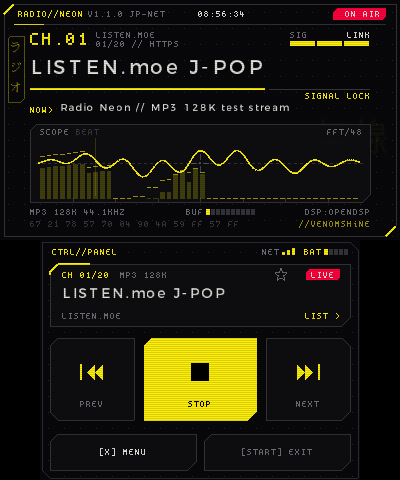 | 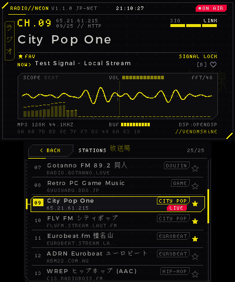 | 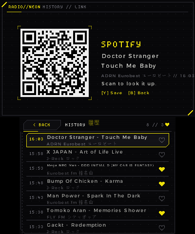 |
| ON AIR | Station list / Lista | Song history + Spotify QR / Historial |
| 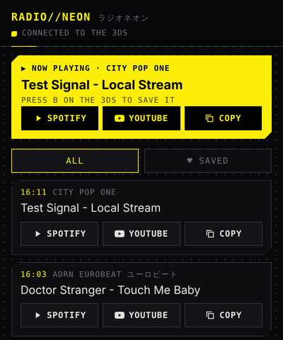 | 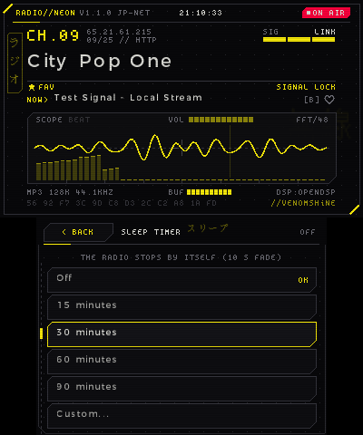 | 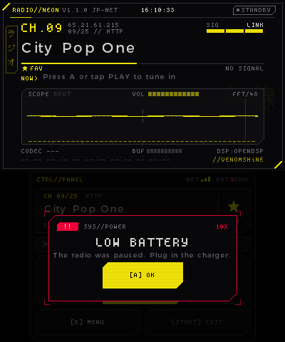 |
| Phone page / Página del móvil | Sleep timer / Temporizador | Low battery / Batería baja |
| 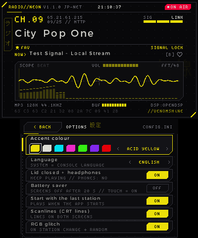 | 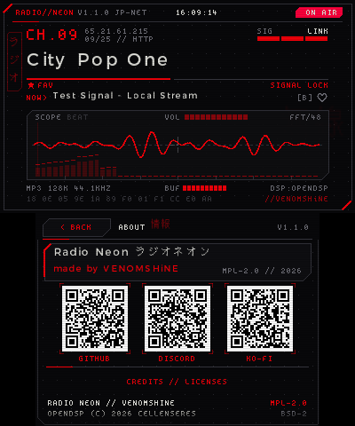 | 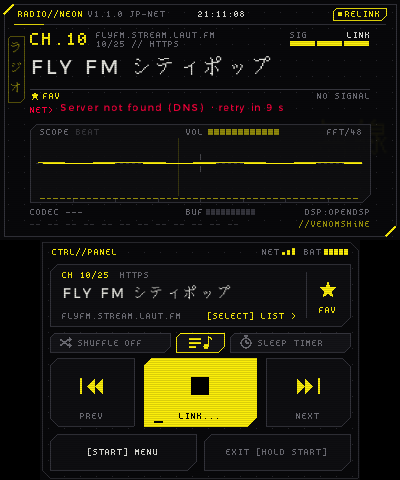 |
| Options / Opciones | About + QR / Acerca de | Network retry / Reintento |
| 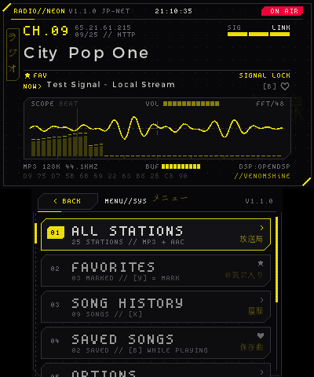 | 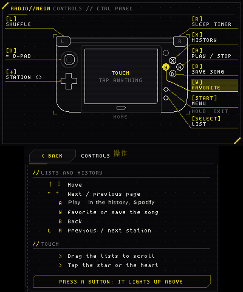 | 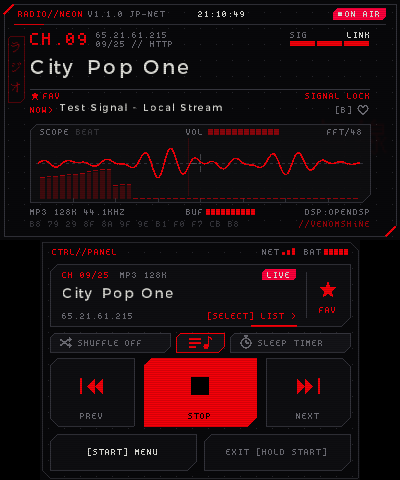 |
| Menu / Menú | Controls / Controles | Red accent / Rojo |
| 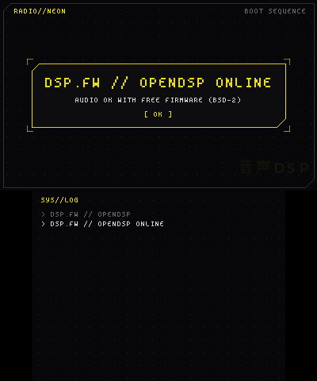 | | |
| OpenDSP boot / Arranque | | |

<sub>Capturas de la 1.1.0 en Azahar con la interfaz en inglés; el audio es una emisora de prueba local («Test Signal») · 1.1.0 screenshots in Azahar, English UI; the audio is a local test stream. Más / more: [docs/screenshots](docs/screenshots) · 1.0.0: [docs/screenshots-1.0.0](docs/screenshots-1.0.0)</sub>

[Español](#español) · [English](#english)

---

## Español

Radio Neon convierte tu 3DS en una radio de música japonesa: J-POP, anime, city pop, eurobeat, J-rock, FM locales de Japón y mucho más. Tiene una estética HUD cyberpunk sobria, con fondo negro carbón y un solo color de acento a tu elección.

### Funciones

- **25 emisoras** listas para escuchar, con su género en la lista: J-POP, anime, Vocaloid, city pop, eurobeat, doujin, música de videojuegos retro, hip-hop, J-rock, visual kei, house de Tokio, jazz, clásica, FM comunitarias japonesas y noticias. Puedes añadir las tuyas en `stations.txt`.
- **MP3 y AAC / AAC+ (HE-AAC)** por `http://` y `https://`, con el título de la canción en directo (metadatos ICY, también en japonés).
- **HTTPS verificado** con los certificados raíz de Mozilla incluidos en la app.
- **Nunca se rinde:** si se corta la emisora o el Wi-Fi, vuelve a conectar sola. Mientras tanto te dice el motivo real (sin Wi-Fi, el servidor no responde, HTTP 404…) y cuánto falta para el siguiente intento.
- **Favoritas** (Y o tocando la estrella) y **aleatorio** (L o su botón): NEXT salta a una emisora al azar sin repetir las últimas.
- **Historial de canciones** (X o el botón del centro): se apuntan solas las que suenan al menos 30 s. **B** guarda con ♥ la que está sonando, con un bip-bip (y otra vez B la quita). En el menú, **Guardadas** muestra solo las del ♥. Desde el historial, un QR abre en el móvil una página con todas las canciones y botones de Spotify, YouTube y Copiar (misma Wi-Fi o el hotspot del móvil; la página solo se puede ver, no toca nada de la consola). Con A, el QR pasa a ser la búsqueda en Spotify de la canción elegida.
- **Aviso de batería baja**, sin molestar: un bip suave cada 5 % desde el 40 %, dos bips cada 2 % desde el 20 %, al 10 % la radio se pausa y te avisa, y al 3 % se bloquea con un cartel fijo hasta que conectes el cargador. Con el cargador puesto no suena nada.
- **Temporizador de apagado** (R o su botón): 15, 30, 60, 90 minutos o los que quieras; la radio baja el volumen poco a poco y se para sola. Con la tapa cerrada, la consola se va a dormir.
- **Osciloscopio y espectro** del audio que suena, con detector de ritmo, y **barra de volumen** que sigue al deslizador de la consola.
- **Tapa cerrada + auriculares:** sigue sonando con las pantallas apagadas. Si quitas los auriculares, se para; nunca suena por los altavoces con la tapa cerrada.
- **Modo ahorro** (opcional, en Opciones): con una emisora sonando, tras 20 s sin tocar nada las dos pantallas se quedan en negro y la app deja de dibujar; la radio sigue. Cualquier botón o tocar la pantalla las devuelve (esa pulsación no hace nada más). La luz de las pantallas no se toca.
- **Controles** en el menú: la consola dibujada con lo que hace cada botón; si pulsas uno, se ilumina.
- Pulsar **HOME**, cerrar la tapa y volver: la radio vuelve a conectar sola.
- Siete colores de acento, scanlines, glitch RGB, y arranque con la última emisora.
- Español, inglés y japonés (o el idioma de la consola).
- Registro `net.log` para diagnosticar problemas de red.

### Instalación

**Con FBI y QR (sin cables):** en FBI ve a *Remote Install* → *Scan QR Code* y escanea el QR de la última versión (o escribe la URL):

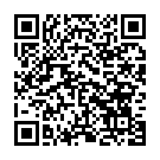

```
https://github.com/venomshine/RadioNeon/releases/latest/download/RadioNeon.cia
```

**Copiando a la SD:**
- `.cia` (icono en el menú HOME): copia `RadioNeon.cia` a la SD e instálalo con FBI.
- `.3dsx` (Homebrew Launcher): copia `RadioNeon.3dsx` a `sdmc:/3ds/`.

Necesitas una 3DS / 2DS / New 3DS con CFW (Luma3DS) y Wi-Fi configurado.

### Controles

| Pantalla | Botones |
|---|---|
| En todas | **START** abre / cierra el menú · **START mantenido 2 s** salir (pregunta antes) · **X** abre / cierra el historial · **SELECT** abre / cierra la lista de emisoras · **L / R** emisora anterior / siguiente (salvo en la principal) |
| Principal | **A** reproducir / parar · **Y** favorita · **← / →** anterior / siguiente · **L** aleatorio · **R** temporizador · **B** guardar / quitar la canción que suena |
| Lista de emisoras | **↑ / ↓** moverse · **← / →** pasar página · **A** reproducir · **Y** favorita · **B** volver |
| Menú | **↑ / ↓** · **A** abrir · **B** cerrar |
| Opciones | **↑ / ↓** · **← / →** o **A** cambiar · **B** volver |
| Temporizador | **↑ / ↓** · **A** elegir · **B** volver |
| Historial | **↑ / ↓** moverse · **← / →** pasar página · **A** QR de Spotify de la canción · **Y** guardar / quitar ♥ · **B** volver |
| Controles | cualquier botón se ilumina en el dibujo · **B** volver |
| Acerca de | **B** volver |

Todo se puede hacer también con la pantalla táctil. El volumen se controla con el deslizador de la consola.

### Archivos en la SD (`sdmc:/3ds/RadioNeon/`)

- `stations.txt`: las emisoras, una por línea con el formato `Nombre | URL | Género` (el género es opcional); `#` es un comentario. Si lo borras, se vuelve a crear con la lista por defecto; si era la lista de serie de una versión anterior y no la habías tocado, se actualiza sola y la vieja queda en `stations.old.txt`. Formatos: MP3 y AAC/AAC+ (ADTS). No se admiten Ogg/Opus, HLS (`.m3u8`) ni listas `.pls`/`.m3u`: pon la URL directa del stream.
- `favorites.txt`: tus favoritas (una URL por línea).
- `history.txt`: el historial de canciones (las últimas 200; las guardadas con ♥ no se borran).
- `config.ini`: las opciones.
- `net.log`: registro de red. Si una emisora te falla, **mándamelo**. En Azahar está en *Archivo → Abrir carpeta de Azahar* → `sdmc/3ds/RadioNeon/`.

Si vienes de la 1.0.0, la carpeta antigua `sdmc:/3ds/radio3ds` se mueve sola a la nueva.

### Audio (firmware DSP)

La app **no incluye ni extrae firmware de Nintendo**. Si tienes `sdmc:/3ds/dspfirm.cdc` (volcado de tu consola con DSP1), lo usa. Si no, usa **OpenDSP**, un firmware libre (BSD-2) que va dentro de la app. El pie de la pantalla de arriba indica cuál está activo (`DSP:`).

### Compilar

Necesitas [devkitPro](https://devkitpro.org) con `3ds-dev 3ds-curl 3ds-mbedtls 3ds-mpg123 3ds-libiconv` (o la imagen Docker `devkitpro/devkitarm`).

```bash
make                 # RadioNeon.3dsx
./build_cia.sh       # RadioNeon.cia (bannertool + makerom)
```

La página del móvil es `web/history.html`: después de cambiarla, `tools/build_web.sh` la comprueba y la deja comprimida en `romfs/web/history.html.gz`. Los gráficos del icono y del banner se generan con `tools/gen_art.py`. El sonido del HOME es `meta/banner_src.wav` (el original), convertido a `meta/banner.wav` (estéreo PCM16 a 32728 Hz) con `tools/banner_wav.py`.

### Licencia

Radio Neon está bajo la **Mozilla Public License 2.0** ([LICENSE](LICENSE)). En [NOTICE.md](NOTICE.md) tienes las licencias de terceros y por qué es MPL y no GPL. Créditos: OpenDSP (Cellenseres), Helix AAC (RealNetworks), libmpg123, libcurl, Mbed TLS, libctru/citro2d/citro3d, qrcodegen (Nayuki) y la fuente Spleen (Frederic Cambus).

---

## English

Radio Neon turns your 3DS into a radio for Japanese music: J-POP, anime, city pop, eurobeat, J-rock, local FM from Japan and much more. It has a clean cyberpunk HUD look, with a carbon-black background and a single accent colour of your choice.

### Features

- **25 stations** ready to play, with their genre in the list: J-POP, anime, Vocaloid, city pop, eurobeat, doujin, retro game music, hip-hop, J-rock, visual kei, Tokyo house, jazz, classical, Japanese community FM and news. Add your own in `stations.txt`.
- **MP3 and AAC / AAC+ (HE-AAC)** over `http://` and `https://`, with the live song title (ICY metadata, Japanese included).
- **Verified HTTPS** with the Mozilla root certificates bundled in the app.
- **Never gives up:** if the stream or the Wi-Fi drops, it reconnects by itself. Meanwhile it shows the real reason (no Wi-Fi, server not responding, HTTP 404…) and a countdown to the next try.
- **Favourites** (Y or tap the star) and **shuffle** (L or its button): NEXT jumps to a random station without repeating the last ones.
- **Song history** (X or the middle button): songs that play for at least 30 s are added by themselves. **B** saves the one playing with a ♥ and a double beep (B again removes it). In the menu, **Saved songs** shows only the ♥ ones. From the history, a QR code opens a page on your phone with every song and Spotify, YouTube and Copy buttons (same Wi-Fi or the phone's hotspot; the page is read only). With A, the QR code becomes the Spotify search for the selected song.
- **Low battery warning**, never intrusive: a soft beep every 5 % from 40 %, two beeps every 2 % from 20 %, at 10 % the radio pauses and tells you, and at 3 % it locks behind a fixed notice until you plug in the charger. Nothing while charging.
- **Sleep timer** (R or its button): 15, 30, 60, 90 minutes or any time you like; the radio fades out and stops by itself. With the lid closed, the console then goes to sleep.
- **Oscilloscope and spectrum** of what is playing, with a beat detector, and a **volume bar** that follows the console's slider.
- **Lid closed + headphones:** keeps playing with the screens off. Unplug the headphones and it stops; it never plays through the speakers with the lid closed.
- **Battery saver** (optional, in Options): while a station plays, after 20 s without touching anything both screens go black and the app stops drawing; the radio keeps going. Any button or a touch brings them back (that press does nothing else). The backlight is left alone.
- **Controls** in the menu: the console drawn with what each button does; press one and it lights up.
- Press **HOME**, or close the lid and come back: the radio reconnects by itself.
- Seven accent colours, scanlines, RGB glitch, and start with the last station.
- Spanish, English and Japanese (or the console language).
- `net.log` to diagnose network problems.

### Install

**FBI over QR (no cables):** in FBI go to *Remote Install* → *Scan QR Code* and scan the QR of the latest release (or type the URL):


```
https://github.com/venomshine/RadioNeon/releases/latest/download/RadioNeon.cia
```

**Copying to the SD card:**
- `.cia` (HOME menu icon): copy `RadioNeon.cia` to the SD card and install it with FBI.
- `.3dsx` (Homebrew Launcher): copy `RadioNeon.3dsx` to `sdmc:/3ds/`.

You need a 3DS / 2DS / New 3DS with CFW (Luma3DS) and Wi-Fi set up.

### Controls

| Screen | Buttons |
|---|---|
| Everywhere | **START** opens / closes the menu · **hold START 2 s** exit (asks first) · **X** opens / closes the song history · **SELECT** opens / closes the station list · **L / R** previous / next station (except on the main screen) |
| Main | **A** play / stop · **Y** favourite · **← / →** previous / next · **L** shuffle · **R** sleep timer · **B** save / unsave the song that is playing |
| Station list | **↑ / ↓** move · **← / →** page · **A** play · **Y** favourite · **B** back |
| Menu | **↑ / ↓** · **A** open · **B** close |
| Options | **↑ / ↓** · **← / →** or **A** change · **B** back |
| Sleep timer | **↑ / ↓** · **A** choose · **B** back |
| Song history | **↑ / ↓** move · **← / →** page · **A** Spotify QR of the song · **Y** save / unsave ♥ · **B** back |
| Controls | any button lights up in the drawing · **B** back |
| About | **B** back |

Everything also works with the touch screen. Volume is the console's slider.

### Files on the SD card (`sdmc:/3ds/RadioNeon/`)

- `stations.txt`: one station per line as `Name | URL | Genre` (the genre is optional); `#` starts a comment. Delete it to get the default list back; if it was an untouched built-in list from an older version, it is updated by itself and the old one is kept as `stations.old.txt`. Formats: MP3 and AAC/AAC+ (ADTS). Ogg/Opus, HLS (`.m3u8`) and `.pls`/`.m3u` playlists are not supported: use the direct stream URL.
- `favorites.txt`: your favourites (one URL per line).
- `history.txt`: the song history (the last 200; songs saved with ♥ are never dropped).
- `config.ini`: the options.
- `net.log`: network log. If a station fails, **send it to me**.

Coming from 1.0.0, the old `sdmc:/3ds/radio3ds` folder is moved to the new one automatically.

### Audio (DSP firmware)

The app **does not include or extract any Nintendo firmware**. If you have `sdmc:/3ds/dspfirm.cdc` (dumped from your console with DSP1) it uses it; otherwise it uses **OpenDSP**, a free firmware (BSD-2) bundled in the app. The footer of the top screen shows which one is active (`DSP:`).

### Build

You need [devkitPro](https://devkitpro.org) with `3ds-dev 3ds-curl 3ds-mbedtls 3ds-mpg123 3ds-libiconv` (or the `devkitpro/devkitarm` Docker image).

```bash
make                 # RadioNeon.3dsx
./build_cia.sh       # RadioNeon.cia (bannertool + makerom)
```

The phone page is `web/history.html`: after editing it, `tools/build_web.sh` checks it and writes the compressed `romfs/web/history.html.gz`. Icon and banner art: `tools/gen_art.py`; HOME menu sound: `meta/banner_src.wav` (original), converted to `meta/banner.wav` (stereo PCM16, 32728 Hz) by `tools/banner_wav.py`.

### License

Radio Neon is released under the **Mozilla Public License 2.0** ([LICENSE](LICENSE)). See [NOTICE.md](NOTICE.md) for third-party licenses and why it is MPL and not GPL. Credits: OpenDSP (Cellenseres), Helix AAC (RealNetworks), libmpg123, libcurl, Mbed TLS, libctru/citro2d/citro3d, qrcodegen (Nayuki) and the Spleen font (Frederic Cambus).
